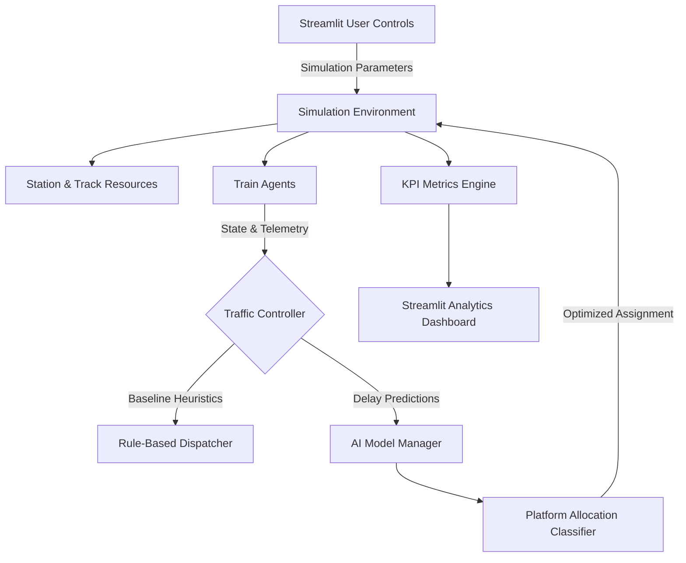

# System Architecture & Design Overview

## Executive Summary
The AI-Powered Train Traffic Control Simulator is a high-fidelity discrete-event simulation engine engineered to evaluate and maximize railway section throughput, punctuality, and incident resilience. Built for the Smart India Hackathon (SIH), it pits standard static rule-based railway scheduling against an adaptive AI-driven dispatching controller.

## Core Architectural Layers
The system is divided into three primary decouple layers:
1. **Simulation Layer (`simulation/`)**: Discrete-event execution powered by SimPy.
2. **Intelligence Layer (`ai/`)**: Feature engineering, delay prediction, and platform allocation classifiers.
3. **Visualization & Analytics Layer (`dashboard/`)**: Interactive Streamlit GUI, KPI telemetry, and scenario comparisons.
\n
### High-Level Component Flow Diagram

\n