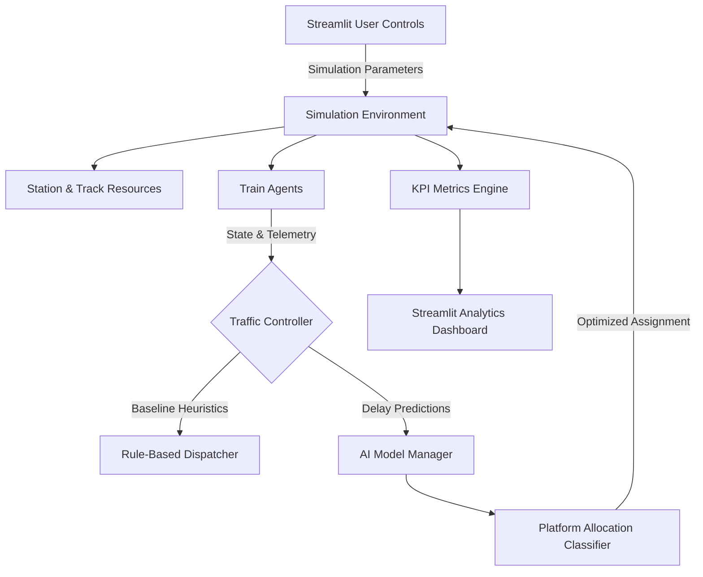

# System Architecture & Design Overview

## Executive Summary
The AI-Powered Train Traffic Control Simulator is a high-fidelity discrete-event simulation engine engineered to evaluate and maximize railway section throughput, punctuality, and incident resilience. Built for the Smart India Hackathon (SIH), it pits standard static rule-based railway scheduling against an adaptive AI-driven dispatching controller.

## Core Architectural Layers
The system is divided into three primary decouple layers:
1. **Simulation Layer (`simulation/`)**: Discrete-event execution powered by SimPy.
2. **Intelligence Layer (`ai/`)**: Feature engineering, delay prediction, and platform allocation classifiers.
3. **Visualization & Analytics Layer (`dashboard/`)**: Interactive Streamlit GUI, KPI telemetry, and scenario comparisons.
\n
### High-Level Component Flow Diagram

\n
## Mathematical Formulation of Section Throughput

Section capacity $C$ over time window $T$ is governed by:
$$C = \frac{T}{h_{avg} + t_{clear}} \cdot \eta_{platform}$$

Where:
- $h_{avg}$: Weighted average minimum headway across train categories.
- $t_{clear}$: Turnaround and switch-lock release time between departures.
- $\eta_{platform}$: Platform utilization efficiency factor.

The AI controller maximizes $\eta_{platform}$ by eliminating idle platform gaps caused by cascading delays.
\n
## Controller Paradigm Comparison

| Feature | Baseline Heuristic Controller | AI-Powered Controller |
| :--- | :--- | :--- |
| **Platform Assignment** | Fixed timetable pre-assignment | Dynamic predicted availability |
| **Delay Response** | Reactive First-Come First-Served | Predictive proactive re-routing |
| **Priority Handling** | Static FIFO queueing | Dynamic priority-weighted penalty function |
| **Deadlock Mitigation** | Timeout backoff heuristic | Lookahead path conflict detection |
| **Incident Recovery** | Linear propagation of delays | Fast localized absorption |
\n
## Deadlock Prevention & Conflict Resolution

In dense railway networks, mutual waiting conditions (train A holding block 1 waiting for block 2, while train B holds block 2 waiting for block 1) cause deadlocks.

### Prevention Strategy
1. **Hierarchical Resource Ordering**: Block sections are ordered strictly along travel vectors.
2. **Lookahead Windowing**: Trains cannot enter a critical junction zone unless the destination block and platform are reserved.
3. **Deadlock Detection Timeout**: The simulation detects if two agents remain stationary for $> 15$ simulation minutes and triggers preemptive AI re-routing.
\n